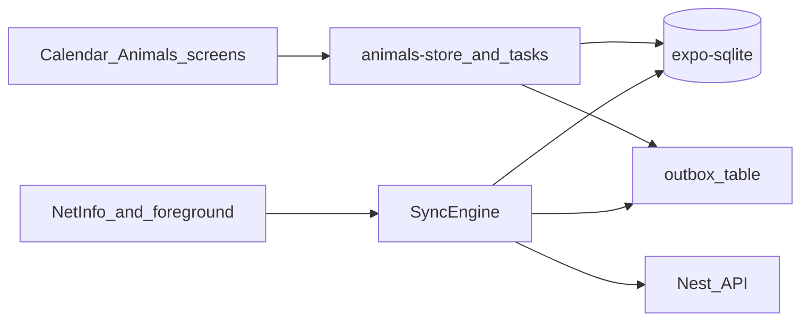

# SQLite offline sync (animals + calendar)

The app is online-only today: [`animals-store.ts`](apps/mobile/src/lib/animals-store.ts) and [`tasks.ts`](apps/mobile/src/lib/tasks.ts) call `fetch` and keep data in memory. [`expo-sqlite`](apps/mobile/package.json) is already in the app and in [`app.json`](apps/mobile/app.json) plugins, but unused. Auth stays in SecureStore. Profile/farm, milk, and finance stay as they are.

Chosen conflict rule: **flush this device’s outbox, then replace SQLite with `GET /animals` + `GET /events`.** No conflict UI. Login still needs the network once; after that the herd and calendar work offline.

## Local model

Add a small DB layer under `apps/mobile/src/lib/db/`:

- `client.ts` — `openDatabaseSync('krave.db')`, run migrations on app start
- `schema.sql` — versioned `PRAGMA user_version` migrations

Tables:

- **`animals`** — same fields as UI `Zival`, plus `server_id` (nullable until first POST succeeds) and `client_id` (UUID, stable)
- **`events`** — same as `Opravilo`, plus `server_id`, `client_id`, `animal_client_id` (so an event can point at an animal that is not on the server yet)
- **`outbox`** — `id INTEGER PK`, `created_at`, `op` (`animal.create` | `animal.patch` | `animal.delete` | `event.create` | `event.delete`), `payload JSON`
- **`meta`** — `farm_id`, `last_sync_at`, `sync_error`

Keep **negative local row ids** (or a separate `local_id`) so the UI can keep using `number` ids before the server SERIAL exists. After a create flushes, rewrite `server_id` and any `events.animal_id` that pointed at that animal.

On **sign-out** (and if `farm.id` changes): wipe animals/events/outbox.

## Write path (optimistic, always)

Change stores so screens barely move:

- `loadAnimals` / `loadOpravila` — **read SQLite**. If online, also kick the sync engine (do not block the UI on the network).
- `addAnimal` / `updateAnimalState` / `removeAnimal` / `createOpravilo` / `deleteOpravilo` — write SQLite immediately, append an outbox row, `emit()`, then `syncNow()` in the background.

Special cases:

- Delete of a **never-synced** row: remove the local row and drop its matching `*.create` outbox entry (never hit the API).
- Event create that references a pending animal: store `animal_client_id`; the engine fills `animalId` after the animal POST.

Calendar and animal screens already call these helpers, so they keep working; they should tolerate a pending/offline banner.

## Sync engine

New [`apps/mobile/src/lib/sync/engine.ts`](apps/mobile/src/lib/sync/engine.ts), started from [`_layout.tsx`](apps/mobile/src/app/_layout.tsx):

1. If no token or offline → stop.
2. Drain **outbox FIFO**. Map each op to existing `api.createAnimal` / `updateAnimal` / `deleteAnimal` / `createEvent` / `deleteEvent`.
3. After the queue is empty (or a row fails), **full pull**: `GET /animals`, `GET /events`, **replace** both tables, then clear synced outbox rows that completed.
4. If a later outbox op fails, **stop the queue**, keep remaining rows, surface `sync_error` (do not pull-replace, or you would drop unsynced local work). Only replace after a successful drain — that is the chosen LWW rule.

Triggers: app foreground, NetInfo `online`, after each mutation, existing `event.*` push listener (already in calendar/home).

Add `@react-native-community/netinfo` (Expo 57 compatible). JWT stays in SecureStore; do not put secrets in SQLite.

## Small API change (needed so retries do not duplicate events)

Animals already dedupe on unique `si_id` (`409`). **Events have no natural key**, so a crash after POST but before deleting the outbox row would create a second opravilo.

Add optional **`clientId` UUID** on [`CreateEventDto`](apps/api/src/events/entities/create-event.dto.ts) and [`CalendarEvent`](apps/api/src/events/entities/event.entity.ts), unique per farm. `POST /events` with an existing `(farmId, clientId)` returns the existing row (idempotent). Same optional `clientId` on animal create: on `409`, treat as success and bind `server_id` from the GET list by `si_id` or `clientId`.

No delta/`since` endpoint and no tombstones in v1: herd + calendar lists are small; full replace after flush is enough. No `PATCH /events` (the app still only creates/deletes events).

## UI

A thin status in calendar + animals (and maybe home): **Brez povezave** / **Sinhronizacija…** / last-sync time / last error. Empty states when never synced and offline: “Ni podatkov — poveži se enkrat.”

Do not change milk/finance mocks or profile/farm APIs in this slice.

## What we are not doing

- PowerSync / WatermelonDB / Electric (extra service; `expo-sqlite` is already in the project)
- Conflict picker UI
- Offline login, account delete, push-token register (those stay online)
- Incremental sync APIs (can add `updatedAt` later if lists grow)
